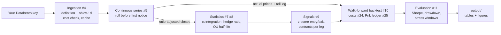

# finm37000-project

[](https://github.com/ryotahidaka/finm37000-project/actions/workflows/tests.yml)

> **Status: Part 3 (building the pipeline).** Scope narrowed to the daily strategy after the professor's review on 18 Oct; see [Future work](#future-work). Run instructions become final once ingestion (#4) lands.

## Team

| Member | GitHub | Part 1 role |
| --- | --- | --- |
| Ryota Hidaka | ryotahidaka | Tech leader (owns this repo) |
| Abinaya Ankur Raut | kira7688 | Communication leader (README) |
| Konark Gupta | konark20 | Design leader (Issues) |
| Raymond Wang | raymondw112 | Design leader (Issues) |

Team communication channel: **WhatsApp**

## Project Summary

#### Q) State the question or application, the CME market(s), and the expected output.

A) We study pairs trading on CME precious metals futures using Databento futures data and analyze the trading feasibility with proper backtesting.**

### Motivation

#### Q) Why is this interesting? What market-structure feature or trading idea does it explore?

A) At the times of inflation and market turmoil, investor prefer safe assets in the form of precious metals. Gold and Silver have seen a huge return in the recent past. However, when positioning in the precious metals, one has to understand the volatility of the asset and balance between these assets. We plan to analyse and come up with a strategy that tries to lever or de-lever out of these positions based on market movements.

### Scope

- **Market(s):** COMEX precious-metals futures: Gold (GC) and Silver (SI), with Micro Gold (MGC) and Micro Silver (SIL) for sizing
- **Frequency:** daily signals on daily closes
- **Date range:** 2010-06-06 (start of `GLBX.MDP3`) to today; stress windows Aug-Dec 2011, Apr 2013, Mar 2020, 2022 (#19)
- **Databento dataset and schema:** `GLBX.MDP3` (CME Globex). Schemas: `definition` and `ohlcv-1d` for every GC and SI contract via parent symbology (`GC.FUT`, `SI.FUT`); optionally `statistics` for settlement and open interest
- **Out of scope:** intraday execution analysis, execution simulation and a copula signal (see [Future work](#future-work)). A Brent/WTI mean-reverting strategy is not permitted for this course.

### How it works



Signals use the ratio-adjusted series so roll gaps never look like price moves; PnL uses actual prices of the contract held that day, with each roll charged explicitly.

### Desired Outcome

By the end of the project, a user can run a single documented workflow that:

1. downloads (or loads cached) Databento CME data,
2. cleans and transforms it,
3. runs the analysis, simulation, or strategy, and
4. writes results (tables, figures, a summary) to an output folder.

#### Q) Describe the final deliverable and the headline results we expect to show.

A) Precious metal investment strategy with levering/de-levering out of positions to get maximum returns and low drawdown.


## Course Logistics

### Data

Data comes from [Databento](https://databento.com/) under the course's CME license.

- A Databento API key is required. Set it as an environment variable; never commit it.
  ```bash
  export DATABENTO_API_KEY="your-key-here"
  ```
- Raw downloads are cached under `data/` (git-ignored) so the same request isn't billed or downloaded twice.
- **Additional data sources:** TODO (none planned yet). If added, document how to obtain them and how to run without them.

### Getting Started

**Requirements:** Python 3.12, git, a Databento API key.

```bash
git clone https://github.com/ryotahidaka/finm37000-project.git
cd finm37000-project

python3.12 -m venv .venv
source .venv/bin/activate
pip install -r requirements.txt   # pinned versions; also installs src/gcsi in editable mode

cp .env.example .env              # then paste your key into .env (git-ignored)
pytest                            # import smoke test; should pass on a fresh clone
```

The key is read from the `DATABENTO_API_KEY` environment variable: export it as above, or put it in `.env`. If neither is set, `gcsi.data` falls back to the course helper `finm37000.get_databento_api_key()`, which reads `~/.databento_api_key`.

`requirements.txt` pins every package, including the course `finm37000` package at a fixed commit. Direct dependencies are declared in `pyproject.toml`. Use `pip install -e ".[dev]"` instead if you only want the latest compatible versions.

### Running the project

```bash
# 1. Fetch and cache data (GC and SI daily bars, every contract, from the dataset start)
python -m gcsi.data --cost-only                          # free: prints the estimated cost
python -m gcsi.data --start 2010-06-06 --end YYYY-MM-DD  # pulls, validates, caches under data/databento/
#    Refuses to pull if the estimate is above --max-cost (default $5) unless you add --yes.
#    A second run is served from the cache and makes no requests.

# 2. Run the analysis / strategy
python -m gcsi.run                                        # TODO

# 3. Results are written to output/
```

### Running the tests

```bash
pytest            # skips tests marked `db` (they need Databento access)
pytest -m db      # run only the Databento tests
```

GitHub Actions ([.github/workflows/tests.yml](.github/workflows/tests.yml)) runs `pytest -q` on Python 3.12, on Linux and Windows, for every pull request to `main` and every push to `main`. It uses no secrets, so `db` tests are always skipped there.

### Repository Layout

```
finm37000-project/
├── README.md
├── pyproject.toml          # package metadata + direct dependencies
├── requirements.txt        # pinned full environment
├── .env.example            # copy to .env and add your Databento key
├── docs/DESIGN.md          # pipeline, components, design decisions
├── src/gcsi/               # pipeline code: data, rolls, cointegration, ou, signals, backtest, metrics
├── notebooks/              # exploration and presentation only
├── tests/
├── data/                   # cached Databento data (git-ignored)
└── output/                 # generated tables and figures (git-ignored)
```

See [docs/DESIGN.md](docs/DESIGN.md) for how the components fit together.

### Roadmap

The work is tracked in the [GitHub Issues](../../issues). Each issue maps to a step in the workflow above.

| Milestone | Course due | Goal |
| --- | --- | --- |
| Part 1 | Lecture 2 | Repo, README, and Issues agreed by all members |
| Part 2 | Lecture 3 | Environment, test fixtures, contract specs, continuous series (#3, #14, #18, #5) |
| Part 3 | Lecture 4 | Ingestion, CI, cointegration and OU, signals, backtest skeleton (#4, #23, #7, #8, #9, #10) |
| Part 4 | Lecture 5 | Cost model, PnL ledger, full backtest, EDA, evaluation (#24, #25, #10, #6, #11) |
| Completion | Final | README with exact run commands, results and presentation (#13) |

### Contributing / Workflow

1. Fork the main repo (owned by the Tech leader) and clone your fork.
2. Create a branch per issue (`git checkout -b issue-<n>-short-name`).
3. Open a Pull Request to the main repo that references the issue (`Closes #<n>`).
4. At least one other team member reviews; the Tech leader merges.
5. Discuss scope changes in the relevant Issue, not offline.

### Future work

Moved out of scope after the professor's review on 18 Oct, which noted the project had two focal points (long-term continuous adjustment and trade-level execution) that could each be a project on their own. Details in [docs/DESIGN.md](docs/DESIGN.md#8-future-work).

- Execution layer: leg the spread on the harder-to-fill side, route across GC/MGC and SI/SIL (was #26)
- Execution simulator on intraday top-of-book (was #27)
- Copula signal as a second strategy (was #12)
- Cross-exchange routing (COMEX vs another venue)

### References

- [Databento documentation](https://databento.com/docs)
- TODO: papers or prior work relevant to the chosen topic
