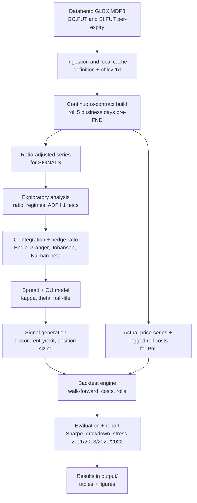
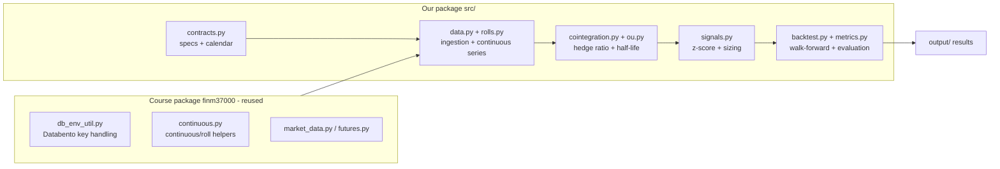

# Project Design: Gold/Silver Futures Pairs Trading

> Design and component overview for the FINM 37000 project. Companion to the README: the README states *what* we deliver and how to run it; this document shows *how the pieces fit together* and *why*. Maintained as part of the Design-leader work; the task breakdown lives in the repo Issues.

## 1. Goal in one line

Build a reproducible pipeline that pulls CME Gold (GC) and Silver (SI) futures from Databento, constructs a statistically valid spread, generates mean-reversion signals, and backtests the strategy with realistic futures costs, then reports honestly whether an edge survives.

## 2. Scope

After the professor's review on 18 Oct we narrowed the project to one focus: a **daily** pairs-trading strategy on GC/SI, with long-run continuous adjustment and an honest, cost-aware backtest. Trade-level execution analysis (legging the spread, routing across standard and micro books, replaying intraday quotes) was a second project in itself, so it moved to [Future work](#8-future-work).

- Signals are generated once a day, on daily closes of the ratio-adjusted continuous series.
- Trades are sized in real contracts (GC/SI, with MGC/SIL for the remainder) and marked on actual prices, with every roll charged explicitly.
- Data: `GLBX.MDP3` from 2010-06-06 (dataset start) to today, `definition` + `ohlcv-1d` per contract via parent symbology (#19).

## 3. Pipeline (data to result)

## 4. Components

We reuse the professor's `finm37000` package for the data and roll plumbing rather than rebuilding it; our package holds the pairs-trading logic on top.

## 5. Key design decisions

| Decision | Choice | Why |
|---|---|---|
| Pair | Gold (GC) vs Silver (SI) | Economically linked precious metals; course-permitted (energy mean-reversion is not) |
| Selection method | Cointegration backbone, distance as benchmark | A single known pair needs no ML search; cointegration gives a tradable spread |
| Hedge ratio | Rolling / Kalman, not static OLS | The GC/SI relationship drifts and breaks in some regimes; a static beta is unsafe |
| Signal | OU half-life + z-score bands | Standard, interpretable; half-life estimated on our data, not borrowed from papers |
| Continuous series | Two series: ratio-adjusted (signals) + real-price (PnL) | Databento continuous prices are unadjusted; mixing adjustment methods corrupts either the signal or the PnL |
| Costs | Half-spread per crossing + fees + roll cost (#24) | A spread crosses the spread on both legs each entry and exit; ignoring this inflates returns |
| Libraries | statsmodels, scipy, pykalman (all free) | No dependency on paid tooling (ArbitrageLab is paid; excluded) |
| Advanced model | None in scope; copula moved to future work | Keeps the two weeks on one well-tested strategy (professor's review, 18 Oct) |

## 6. How the Issues map to components

| Issue | Component | Produces |
|---|---|---|
| #3 Structure + env | repo root | installable environment |
| #18 Contract specs | `contracts.py` | multipliers, ticks, FND / last-trade calendar |
| #4 Databento ingestion | `data.py` | cached GC/SI frames |
| #5 Continuous + roll | `rolls.py` | ratio-adjusted + real-price series |
| #6 EDA | `report.py` (`eda`) | cointegration by year, half-life by window, tradability assessment |
| #7 Cointegration + hedge ratio | `cointegration.py` | spread definition |
| #8 OU + half-life | `ou.py` | reversion parameters |
| #9 Signal generation | `signals.py` | dated positions |
| #10 Backtest | `backtest.py` | equity curve with costs |
| #24 Cost model | `costs.py` | cost per fill and per roll |
| #25 PnL ledger | `ledger.py` | fills, daily PnL split into ideal spread / whole-contract sizing / trade costs / roll costs |
| #23 CI | `.github/workflows` | tests on every PR |
| #11 Evaluation | `metrics.py` + `report.py` -> `output/` | metrics, stress windows, report.md + figures |

## 7. Central risk (state it up front)

The gold/silver long-run relationship is **not stable**. The empirical literature finds cointegration in some periods and breakdown in others (notably the 1990s, and blow-outs in 2011 and March 2020). We therefore treat "the pair is cointegrated" as a hypothesis to test across sub-periods, use strictly out-of-sample calibration, and report whether the edge survives transaction costs rather than assuming it does. A clear negative result, honestly shown, is a valid and strong outcome for this project.

## 8. Future work

Out of scope for this course after the 18 Oct review; kept here so the ideas aren't lost.

| Idea | Why it's interesting | Why it's out of scope now | Was |
|---|---|---|---|
| Execution layer | Leg the spread on the harder-to-fill side and hit the hedge on the other; route each leg between standard and micro books (GC/MGC, SI/SIL) | A separate trade-level project; needs intraday data and its own validation | #26 |
| Execution simulator | Replay intraday top-of-book to measure what the execution layer saves versus crossing both legs | Needs MBP-1 / BBO history and a fill model; only useful with the execution layer | #27 |
| Copula signal | A genuinely bivariate signal to compare with cointegration / OU | Gains are usually marginal after costs; adds a second strategy to validate | #12 |
| Cross-exchange routing | Same legging idea across COMEX and another venue (MCX, SGE, LME precious) | Data outside the course licence, FX conversion, trading-hours overlap | (idea) |

