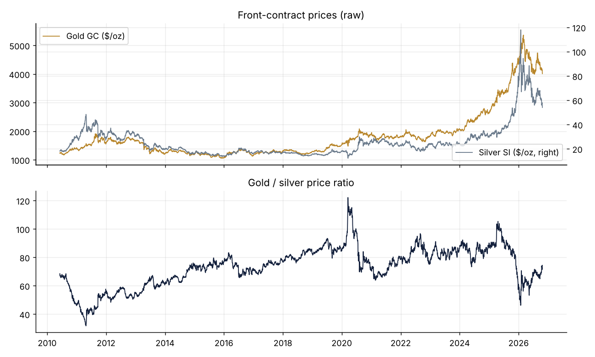
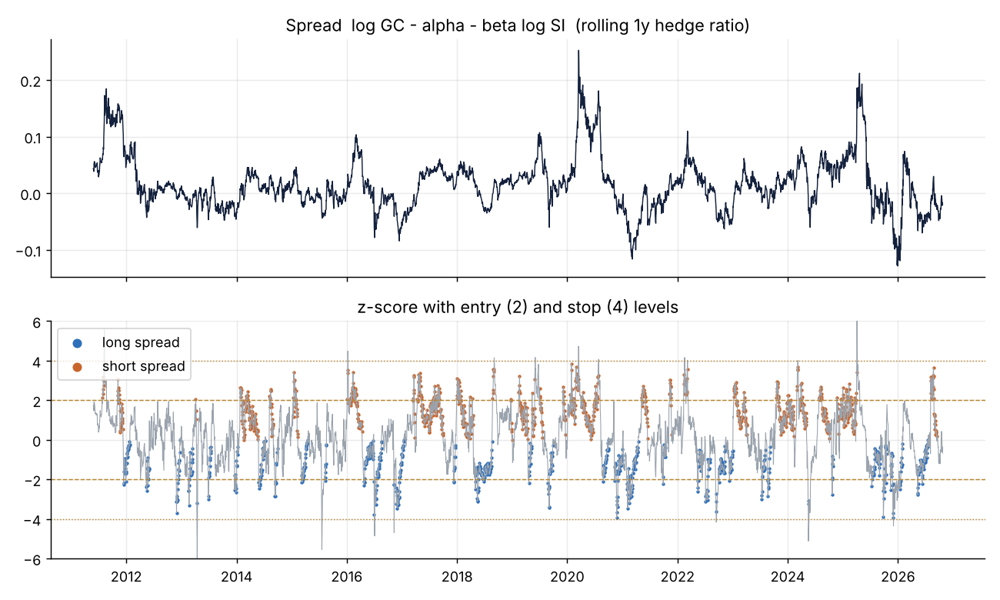
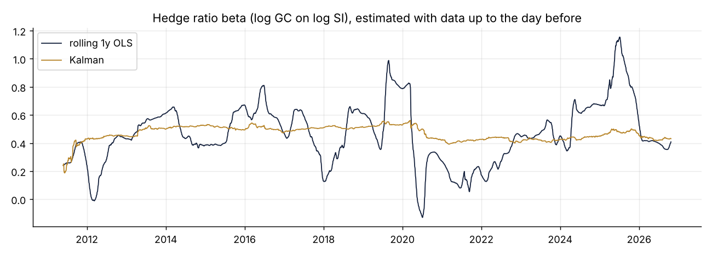
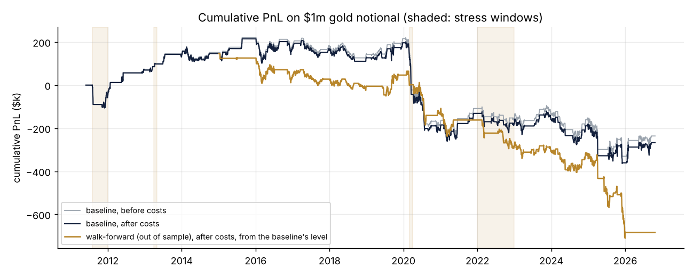
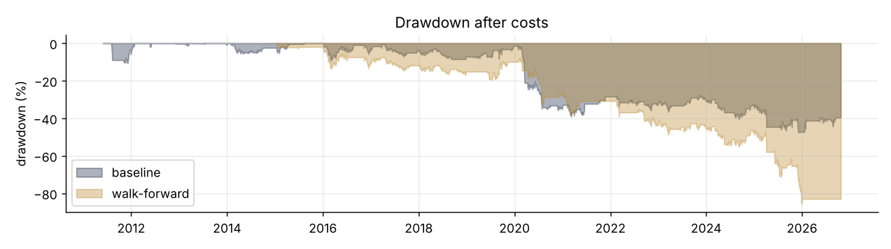

# GC/SI pairs backtest: results (databento data)

Data 2010-06-07 to 2026-10-23, 4,248 trading days with both legs. Rolls: 81 gold, 82 silver (5 business days before first notice).

## Headline: walk-forward, out of sample, after costs

Test years 2015 to 2026; each year uses the best (entry, z lookback) on the previous 3 years.

| Metric | After costs | Before costs |
| --- | --- | --- |
| Sharpe | -0.85 | -0.83 |
| Annual return on $1m | -6.8% | -6.6% |
| Annual volatility | 8.0% | 8.0% |
| Max drawdown | -85.7% | -83.4% |
| Total PnL | $-830,189 | $-806,797 |

Trades: 43 round trips (3.5 a year), average holding 33.8 days, win rate 37.2%.

PnL attribution (USD): ideal spread $-806,400, whole-contract sizing $-397, trade costs -$16,357, roll costs -$7,035, net $-830,189.

## Baseline: pre-committed parameters, full history after warm-up

Sharpe -0.21, annual return -1.7%, max drawdown -47.6%, 72 round trips, average holding 25.8 days. Costs: trades $23,520, rolls $7,459, against gross PnL $-236,198.

## Is the pair cointegrated?

Full sample Engle-Granger: beta 0.590, p-value 0.8703 (t -1.15 vs 5% critical -3.34). Johansen rank 0, beta 1.069. Cointegrated at 5% in 2 of 17 single years; yearly beta from 0.15 to 0.79. Daily return correlation 0.79.

OU half-life of the full-sample spread: 940.5 trading days. By window (last N days): 126d 14.3, 252d 12.2, 504d 36.8, 1008d 98.3.

Gold/silver ratio: last 74.3, range 31.7 to 122.1.

## Stress windows (baseline)

| Window | PnL | Sharpe | Max DD | Beta range |
| --- | --- | --- | --- | --- |
| Aug-Dec 2011 | $-50,140 | -1.16 | -10.7% | 0.25 to 0.41 |
| Apr 2013 | $12,185 | 3.47 | -0.3% | 0.48 to 0.53 |
| Mar 2020 | $-168,792 | -6.96 | -17.1% | 0.46 to 0.83 |
| 2022 | $-46,904 | -0.67 | -9.7% | 0.13 to 0.47 |

## Sensitivity (baseline parameters)

| Variant | Sharpe | Annual return | Max DD | Trades/yr | Costs |
| --- | --- | --- | --- | --- | --- |
| baseline | -0.21 | -1.7% | -47.6% | 4.5 | $30,979 |
| no costs | -0.19 | -1.5% | -45.4% | 4.5 | $0 |
| costs x2 | -0.24 | -1.9% | -49.9% | 4.5 | $61,957 |
| fill at signal close | -0.23 | -1.8% | -49.8% | 4.5 | $31,170 |
| Kalman hedge ratio | -0.10 | -0.8% | -36.7% | 4.0 | $32,161 |
| simple z-score | -0.15 | -1.2% | -41.9% | 4.5 | $31,741 |
| dollar-neutral | 0.15 | 2.0% | -32.8% | 4.5 | $48,419 |
| no micros | -0.19 | -1.5% | -45.6% | 4.5 | $25,740 |

## Out-of-sample PnL by year

| Year | PnL | Return | Sharpe | Chosen entry / z_lookback |
| --- | --- | --- | --- | --- |
| 2015 | $-20,736 | -2.1% | -0.84 | 2.5 / 40 |
| 2016 | $-81,009 | -8.1% | -0.90 | 1.5 / 60 |
| 2017 | $-17,093 | -1.7% | -0.31 | 1.5 / 120 |
| 2018 | $-32,414 | -3.2% | -0.55 | 1.5 / 120 |
| 2019 | $51,261 | 5.1% | 0.68 | 2.5 / 120 |
| 2020 | $-170,284 | -17.0% | -1.58 | 2.5 / 120 |
| 2021 | $-38,384 | -3.8% | -0.57 | 2.5 / 120 |
| 2022 | $-122,882 | -12.3% | -1.69 | 2.5 / 120 |
| 2023 | $-22,978 | -2.3% | -0.34 | 1.5 / 40 |
| 2024 | $-34,035 | -3.4% | -0.38 | 1.5 / 60 |
| 2025 | $-340,304 | -34.0% | -2.15 | 2 / 40 |
| 2026 | $-1,330 | -0.1% | -1.09 | 2 / 120 |

## Assumptions

Gold notional $1,000,000 per trade, beta-neutral with micros, fills 1 day after the signal at the raw close. Cost per contract per side (USD): GC 7.50, MGC 1.45, SI 15.00, SIL 3.45 (half a tick + exchange fee + commission; see gcsi/costs.py).

## Figures

